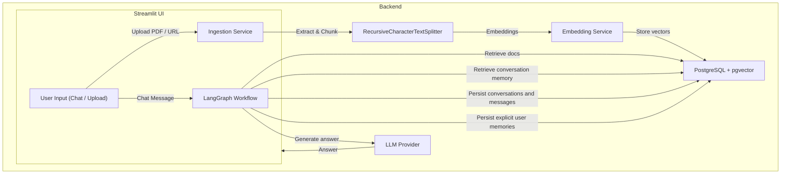

# Personal RAG Chatbot

## Architecture Overview



- **UI** – Streamlit front‑end with a chat window and a sidebar for uploading PDFs or entering NPTEL / YouTube URLs.
- **Ingestion** – Extracts raw text from PDFs, web pages, and YouTube captions, chunks it with `RecursiveCharacterTextSplitter`, computes embeddings, and stores chunks + vectors in PostgreSQL (`pgvector`).
- **Vector Store** – PostgreSQL with pgvector; document knowledge, conversation messages, and user memories use separate tables.
- **Workflow** – LangGraph state‑graph clarifies follow-up queries from bounded conversation history, then retrieves documents and optional user memories before answer generation.
- **LLM** – Google Gemini (`gemini‑2.5‑flash`) by default, with optional OpenAI or a local model via Ollama.
- **Embedding** – Default free local model (`sentence‑transformers/all‑MiniLM‑L6‑v2` or `BAAI/bge‑small‑en‑v1.5`).  Switch to OpenAI embeddings (`text‑embedding‑3‑small`) via an env variable.
- PDF ingestion stores the original one-based page number with each chunk. Answers include page references when available, and the Sources expander shows the page and retrieved excerpt. Non-PDF sources and existing PDF chunks without page metadata do not show a page number; re-ingest older PDFs to add page citations.
- The custom `embeddings.embedding` column uses an unconstrained pgvector `VECTOR` so it accepts the configured model's output dimension (MiniLM produces 384, while other models may differ). Database initialization migrates an existing dimension-constrained column without deleting stored vectors.

## Folder Structure

```
rag_chatbot/
├─ backend/
│   ├─ __init__.py
│   ├─ database.py          # PostgreSQL helpers & schema init
│   ├─ embeddings.py        # Embedding function selector
│   ├─ evaluation.py        # Dataset-based RAG evaluation with an LLM judge
│   ├─ ingestion.py         # PDF / web / YouTube ingestion pipeline
│   ├─ memory.py            # Explicit long-term memory extraction and safety checks
│   └─ workflow.py          # LangGraph RAG state‑graph definition
├─ frontend/
│   └─ app.py               # Streamlit chat UI and ingestion widgets
├─ tests/                   # Unit tests for conversation, memory, and RAG evaluation
├─ docker-compose.yml       # PostgreSQL + pgvector container
├─ requirements.txt
└─ README.md                # (this file)
```

## Setup & Execution Guide

1. **Clone / copy the repository** into `C:\Users\VARAD\OneDrive\Desktop\AIML-Project` (already done).
2. **Create a virtual environment** and install dependencies:
   ```powershell
   python -m venv .venv
   .venv\Scripts\activate
   pip install -r requirements.txt
   ```
3. **Environment variables** – create a `.env` file at the project root:
   ```dotenv
   # Google Gemini API key (get one from Google AI Studio)
   GOOGLE_API_KEY=your-gemini-api-key
   LLM_PROVIDER=gemini
   GEMINI_MODEL=gemini-2.5-flash

   # Choose embedding model (default local MiniLM)
   EMBEDDING_MODEL=sentence-transformers/all-MiniLM-L6-v2
   # To use OpenAI embeddings set EMBEDDING_MODEL=openai and optionally:
   # OPENAI_EMBEDDING_MODEL=text-embedding-3-small

   # Database connection (defaults match docker-compose.yml)
   POSTGRES_USER=rag_user
   POSTGRES_PASSWORD=rag_password
   POSTGRES_DB=rag_db
   POSTGRES_HOST=localhost
   POSTGRES_PORT=5432
   RAG_USER_ID=default
   CHAT_HISTORY_TURNS=8

   # If using Ollama, specify the model name, e.g.:
   # OLLAMA_MODEL=llama3:8b
   ```
4. **Start PostgreSQL with pgvector**:
   ```powershell
   docker compose up -d
   ```
   The container is named `rag-postgres` and listens on `localhost:5432`.
5. **Initialize the database schema** (run once):
   ```powershell
   python -c "import backend.database as db; db.init_db()"
   ```
6. **Ingest knowledge** – you can run the ingestion script directly or use the Streamlit UI:
   ```powershell
   # PDF example
   python -m backend.ingestion --pdf path\to\lecture.pdf

   # Web page example
   python -m backend.ingestion --url https://nptel.ac.in/course/... 

   # YouTube video (captions must be available)
   python -m backend.ingestion --youtube https://www.youtube.com/watch?v=ABC123
   ```

   YouTube ingestion prefers English captions and falls back to Hindi captions.
7. **Launch the chat UI**:
   ```powershell
   streamlit run frontend/app.py
   ```
   Open the displayed URL (usually `http://localhost:8501`).  Use the sidebar to add new PDFs / URLs and chat with the assistant.
   The app shows an ingestion-in-progress message while processing and confirms when the document or source has been ingested.

## Conversations and memory

The sidebar supports multiple conversations, each with a stable UUID thread ID,
its own persisted message history, concise title, rename/delete controls, and
most-recently-updated ordering. Conversation records and messages are stored
separately from the RAG documents; deleting a conversation only deletes its
messages. Messages are reloaded from PostgreSQL on each Streamlit rerun, so
switching conversations or reconnecting does not mix their short-term context.
When a question is submitted, it appears immediately while the assistant shows
a thinking indicator. Answers include an expandable source/context section with
the retrieved document name, chunk number, and a short excerpt when available.

The last `CHAT_HISTORY_TURNS` turns (default `8`, maximum `50`) are used as
short-term context. When there is prior history, the workflow first rewrites a
follow-up into a standalone document-search query. No LangGraph checkpoint
dependency is required: PostgreSQL conversation messages are the durable
short-term history.

**Use long-term memory** is enabled by default. When enabled, relevant saved
user preferences and study facts are retrieved separately from document
evidence. The app asks the configured LLM to extract candidate memories only
from explicit, durable user statements (for example, “I prefer concise
explanations”); it does not save every assistant response or ordinary question.
Memories are keyed and upserted so new values replace outdated ones. Messages
that appear to contain secrets or sensitive information are not passed to the
memory extractor, and matching candidate memories are rejected. Manage Memories
lets users inspect/delete individual memories or confirm clearing all memories.
Each extraction is capped at five distinct facts, and each user has a limit of
100 saved memories. Turning memory off disables both retrieval and saving while
retaining short-term conversation history.

Set `RAG_USER_ID` in `.env` or deployment secrets to choose the persistence
namespace (default: `default`). This project does not implement authentication:
a shared environment variable is **not** multi-user authentication or access
control. For a multi-user deployment, derive this identifier from a trusted,
authenticated identity before exposing the app to users.

On startup, `init_db()` safely creates the `conversations`,
`conversation_messages`, and `user_memories` tables and indexes if missing. It
does not remove or overwrite existing document chunks. Existing
`conversation_memories` data from the earlier implementation is left intact;
new chats no longer store every question/answer as long-term memory, and the
**Clear long-term memory** action also removes those legacy rows for the
configured user.

Run the automated tests with:

```powershell
python -m unittest discover -s tests -v
```

## RAG evaluation

The original custom LLM-judge evaluator remains available as
`backend.evaluation`. For standard Ragas metrics, create a UTF-8 JSON Lines
dataset with one object per test case. `question` is required;
`reference_answer` (or `ground_truth`) is optional:

```json
{"question":"What is the first law of thermodynamics?","reference_answer":"Energy is conserved; it can change forms but cannot be created or destroyed."}
{"question":"Summarize the uploaded lecture's definition of entropy."}
```

Run the separate Ragas evaluator after ingesting the knowledge you want to test:

```powershell
pip install -r requirements.txt
python -m backend.ragas_evaluation --dataset eval.jsonl --output ragas_results.json
```

The runner invokes the existing RAG workflow with long-term memory disabled,
then scores faithfulness and answer relevancy for all examples. If examples
include reference answers, Ragas also calculates context precision, context
recall, and answer correctness for those rows. The JSON report includes
per-example answers, retrieved contexts, available metric scores, and mean
scores. It uses the configured LLM provider and embedding model; evaluation
calls may use API credits. Ragas metrics are LLM/embedding-based estimates, not
a substitute for reviewing representative results.

Switching providers only requires changing `LLM_PROVIDER` and, for embeddings,
`EMBEDDING_MODEL` in `.env`.

## Deployment

Deploy `frontend/app.py` on Streamlit Community Cloud or another Streamlit host, and use a reachable PostgreSQL service with the pgvector extension. Set the required variables in the host's environment or secrets manager. For Streamlit Community Cloud, add top-level entries to the app's Secrets settings:

```toml
GOOGLE_API_KEY = "your-gemini-api-key"
LLM_PROVIDER = "gemini"
GEMINI_MODEL = "gemini-2.5-flash"
EMBEDDING_MODEL = "sentence-transformers/all-MiniLM-L6-v2"
POSTGRES_USER = "your-db-user"
POSTGRES_PASSWORD = "your-db-password"
POSTGRES_DB = "your-db-name"
POSTGRES_HOST = "your-db-host"
POSTGRES_PORT = "5432"
POSTGRES_SSLMODE = "require"
RAG_USER_ID = "default"
CHAT_HISTORY_TURNS = "8"
```

For OpenAI, set `LLM_PROVIDER = "openai"` and `OPENAI_API_KEY`; for Ollama, set `LLM_PROVIDER = "ollama"` and `OLLAMA_MODEL`. The Streamlit host must be able to reach an Ollama service. Do not use `localhost` for a database or Ollama service hosted on a different machine. The app initializes its database schema on first use, so the database credentials must have permission to create the pgvector extension and tables (or have them provisioned before launch). Keep `.env` and deployment secrets out of source control.

Happy studying! 🚀
